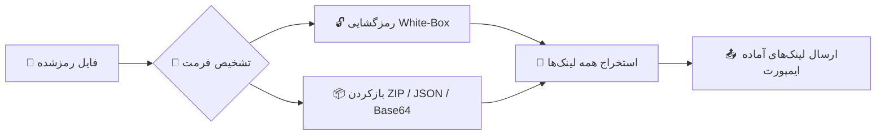

<div align="center">

**فارسی** | [English](README.md)

# 🔐 NPVT Decryptor Bot

**ربات تلگرامی رمزگشای کانفیگ — استخراج لینک‌های پروکسی استاندارد از فرمت‌های رمزشده**


**NPVT · NPVS v1 · NPVS v5 (Gen2) · EHI · HA Tunnel · Happ · SlipNet · NetMod · DarkTunnel**

</div>

---

> ⚠️ **سلب مسئولیت:** این ابزار برای رمزگشایی کانفیگ‌هایی است که خودتان ساخته‌اید یا رمز آن‌ها به‌صورت عمومی منتشر شده است. مسئولیت نحوه استفاده با کاربر است.

---

## ✨ ویژگی‌ها

- 🔓 **رمزگشایی ۱۰+ فرمت** اپ‌های تونل محبوب — NPVT، NPVS (نسل ۱ و ۲)، EHI، HA Tunnel، Happ، SlipNet، NetMod و DarkTunnel
- 🔗 **استخراج کامل:** از هر رکورد، همه outbound ها × همه سرورها × همه کاربران لینک ساخته می‌شود (حالت‌های multi-server / multi-user)
- 🐣 **تبدیل خودکار hyq** به لینک استاندارد `hysteria2://` — قابل ایمپورت در همه کلاینت‌ها
- 📦 **بسته‌های تو در تو:** ZIP تا ۳ لایه، JSON توکار (v2rayJson و پروفایل‌های napsternetV)، Base64 و Hex
- 🧠 **Dedupe هوشمند:** فقط تکراری‌های واقعی حذف می‌شوند؛ واریانت‌های واقعی (pbk / sid / path متفاوت) حفظ می‌شوند
- 🏆 **کاملاً خودکفا:** همه جداول White-Box داخل خود ریپو هستند — بدون هیچ دانلود خارجی، حتی بدون اینترنت بالا می‌آید
- 🩺 **لاگ تشخیصی:** برای هر رکورد دقیقاً معلوم است چه اتفاقی افتاده (`📋 ▶️ ⚠️ 📊`)
- 📊 **مدیریت کامل:** آمار استفاده، پیام همگانی (broadcast) و جوین اجباری کانال

## 🧭 جریان پردازش



## 📋 فرمت‌های پشتیبانی‌شده

### 🟢 خانواده NPV Tunnel

| فرمت | نوع قفل | رمز لازم؟ |
|:---|:---|:---:|
| `.npvt` | رمزنگاری White-Box چندلایه | ❌ |
| `.npvs` v1 — Passphrase | PBKDF2 + ChaCha20-Poly1305 | ✅ |
| `.npvs` v1 — AppKey | White-Box AES (نسل ۱) | ❌ |
| `.npvs` v5 (Gen2) — Passphrase | PBKDF2 + HKDF + رکوردهای رمز | ✅ |
| `.npvs` v5 (Gen2) — Anyone with the app | White-Box AES (نسل ۲) | ❌ |
| `.npvs` v5 (Gen2) — Keep open (`NPVO1`) | بدون قفل | ❌ |
| `.npvs` v5 (Gen2) — Specific people (E2E) | رمزنگاری گیرنده‌محور | 🔒 فقط با کلید گیرنده |
| `NPVT1` / `NPVTSUB1` | مرجع‌های قدیمی (legacy) | ❌ |

### 🟢 اپلیکیشن‌های دیگر

| فرمت | اپلیکیشن |
|:---|:---|
| `.ehi` | HTTP Injector |
| `.hat` | HA Tunnel Plus |
| `.happ` | Happ |
| `.slip` | SlipNet |
| `.nm` | NetMod |
| `.dark` | DarkTunnel |

### 🟢 عمومی

- فایل‌های **ZIP** (تو در تو تا ۳ لایه)
- **JSON** — شامل v2rayJson توکار و پروفایل‌های napsternetV
- **Base64 / Hex**
- **لینک‌های خام:** `vless` · `vmess` · `trojan` · `ss` · `ssr` · `hysteria` · `hysteria2` · `tuic`

## 🚀 نصب سریع

### 🐳 گزینه ۱ — Docker (همه در یک خط)

```bash
git clone https://github.com/arash7898666/bot.git && cd bot && docker build -t npvtbot . && docker run -d --name npvtbot -e BOT_TOKEN="123456:ABC-DEF..." -e ADMIN_IDS="123456789" --restart unless-stopped npvtbot
```

مدیریت کانتینر:

```bash
docker logs -f npvtbot                             # لاگ زنده
docker restart npvtbot                             # ری‌استارت
docker stop npvtbot && docker rm npvtbot           # حذف
```

### ☁️ گزینه ۲ — Render (بدون سرور)

1. این ریپو را **Fork** کنید
2. در [Render Dashboard](https://dashboard.render.com) → **New** → **Web Service** ریپو را وصل کنید — Runtime: **Docker**
3. در بخش **Environment** متغیرهای `BOT_TOKEN` و `ADMIN_IDS` را اضافه کنید
4. **Create Web Service** — دیپلوی خودکار شروع می‌شود 🎉

### 🖥️ گزینه ۳ — VPS با Go

نیازمند Go 1.22+ :

```bash
git clone https://github.com/arash7898666/bot.git && cd bot
go mod tidy
go build -o npvtbot .
BOT_TOKEN="123456:ABC-DEF..." ADMIN_IDS="123456789" ./npvtbot
```

### ⏰ اجرای دائمی با systemd

فایل `/etc/systemd/system/npvtbot.service` بسازید:

```ini
[Unit]
Description=NPVT Decryptor Bot
After=network.target

[Service]
WorkingDirectory=/opt/bot
ExecStart=/opt/bot/npvtbot
Environment=BOT_TOKEN=123456:ABC-DEF...
Environment=ADMIN_IDS=123456789
Restart=always
RestartSec=5

[Install]
WantedBy=multi-user.target
```

فعال‌سازی:

```bash
sudo mkdir -p /opt/bot        # باینری npvtbot و فایل‌های پروژه را اینجا بگذارید
sudo systemctl daemon-reload
sudo systemctl enable --now npvtbot
sudo journalctl -u npvtbot -f  # لاگ زنده
```

## ⚙️ متغیرهای محیطی

| متغیر | الزامی | پیش‌فرض | توضیح |
|:---|:---:|:---:|:---|
| `BOT_TOKEN` | ✅ | — | توکن ربات از [@BotFather](https://t.me/BotFather) |
| `ADMIN_IDS` | ❌ | خالی | آیدی عددی ادمین‌ها با کاما: `123,456` |
| `FORCE_CHANNEL` | ❌ | خالی | کانال جوین اجباری (یا با `/setchannel` داخل ربات) |
| `DEBUG` | ❌ | `0` | `1` = لاگ تشخیصی بیشتر |
| `PORT` | ❌ | `8080` | پورت سرور health-check |

## 🤖 دستورات ربات

| دستور | سطح دسترسی | توضیح |
|:---|:---:|:---|
| `/start` | همه | شروع و راهنما |
| `/help` | همه | راهنمای استفاده |
| `/formats` | همه | لیست فرمت‌های پشتیبانی‌شده |
| `/version` | همه | نمایش نسخه ربات |
| `/channel` | همه | وضعیت جوین اجباری |
| `/setchannel @name` | ادمین | تنظیم کانال جوین اجباری (`off` = غیرفعال) |
| `/stats` | ادمین | آمار کاربران و پردازش‌ها |
| `/broadcast متن` | ادمین | ارسال پیام همگانی |

## 🧩 جداول White-Box — کاملاً خودکفا

برای بازکردن قفل‌های «بدون رمز»، ربات به جداول White-Box (نسل ۱ و ۲) نیاز دارد — و **هر دو داخل خود ریپو هستند:**

| نسل | فایل‌ها |
|:---|:---|
| ۱ | `tables.txt` + `tyboxes.bin` · `mbl.bin` · `xor.bin` · `tboxes_last.bin` · `tboxes_last_v2.bin` |
| ۲ | `gen2_tables.bin.z` |

یعنی ربات **بدون هیچ دانلود خارجی و حتی بدون اینترنت** بالا می‌آید ✅

علامت سلامت در لاگ استارت:

```text
✅ جداول رمزنگاری بارگذاری شد
⚡ جداول NPVS آماده شد (۳ نسخه tboxes_last) | 🧪 WB SelfTest: 2/2 KDK درست
✅ جداول Gen2 White-Box آماده شد (749568 بایت)
```

> فایل‌های کش (`npvs_cache_*` و `npvt_tables_cache.txt`) به‌صورت خودکار ساخته می‌شوند و در `.gitignore` هستند.

## 🔄 تغییرات نسخه v8.3-FINAL

- 🔗 **فیکس بزرگ استخراج:** همه سرورها × کاربرها از هر outbound لینک می‌سازند — مشکل «۷ کانفیگ داخل، ۳ خروجی» برای همیشه حل شد
- 🐣 **تبدیل hyq → hysteria2:** outbound های vless-روی-hysteria به لینک استاندارد `hysteria2://` تبدیل می‌شوند
- ♻️ **بازیابی از dump:** لینک‌های گم‌شده در dump های متنی با موتور JSON نجات داده می‌شوند
- 🧹 **Dedupe هوشمند:** فقط تکراری‌های واقعی حذف می‌شوند؛ کانفیگ‌هایی که در پارامترهای query فرق دارند حفظ می‌شوند
- 📊 **لاگ تشخیصی:** `📋 جدول sentinel` · `▶️ کانفیگ #N` · `⚠️ خالی` · `📊 آمار` — هر رکورد قابل ردیابی است
- 🏆 **خودکفایی جداول:** `gen2_tables.bin.z` به ریپو اضافه شد — بدون وابستگی به هیچ ریپوی خارجی

## 🩺 عیب‌یابی

| نشانه | معنی | راه‌حل |
|:---|:---|:---|
| `Conflict: terminated by other getUpdates request` | دو instance با یک توکن روشن است | فقط **یک** سرویس اجرا کنید (VPS *یا* Render) |
| چند ثانیه Conflict بلافاصله بعد از deploy روی Render | هم‌پوشانی instance قدیمی و جدید حین deploy | طبیعی است — خودش برطرف می‌شود |
| `❌ BOT_TOKEN تنظیم نشده.` | متغیر محیطی ست نشده | در Docker با `-e`، در Render در بخش Environment |
| پاسخ‌دهی کند بعد از چند ساعت بی‌کاری روی Render Free | سرویس Free بعد از بی‌فعالیتی خواب می‌رود | اولین درخواست کمی طول می‌کشد — یا پلن پولی |
| `⚠️ کانفیگ #N → خالی` در لاگ | آن رکورد خاص خروجی نداشته | لاگ را برای توسعه‌دهنده بفرستید |

## 🛡️ نکات امنیتی

- توکن ربات **هرگز commit نشود** — همیشه از متغیر محیطی خوانده می‌شود. اگر لو رفت، در BotFather با `/revoke` توکن جدید بگیرید
- فایل‌های `bot_settings.json` و `bot_stats.json` حاوی اطلاعات کاربران‌اند — آن‌ها را عمومی نکنید
- ربات را فقط در **یک مکان** اجرا کنید (VPS یا Render، نه هر دو)

## 🛠️ تکنولوژی

**Go 1.22** · Telegram Bot API · ChaCha20-Poly1305 · PBKDF2 · HKDF · Argon2id · White-Box AES (Gen1 / Gen2) · XXTEA · MsgPack

## 🙏 منابع

- فرمت NPVS: بازمهندسی‌شده از [Pantegnos](https://github.com/FrontierTM/Pantegnos)
- [go-telegram-bot-api](https://github.com/go-telegram-bot-api/telegram-bot-api) · [golang.org/x/crypto](https://pkg.go.dev/golang.org/x/crypto) · [vmihailenco/msgpack](https://github.com/vmihailenco/msgpack)

## 📄 لایسنس

**MIT**

---

<div align="center">

**ساخته‌شده با ❤️ — اگر مفید بود، یک ⭐ بده!**

</div>
