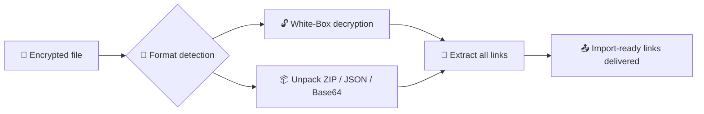

<div align="center">

**English** | [فارسی](README.fa.md)

# 🔐 NPVT Decryptor Bot

**Telegram config-decryption bot — extracts standard proxy links from encrypted tunnel-app formats**


**NPVT · NPVS v1 · NPVS v5 (Gen2) · EHI · HA Tunnel · Happ · SlipNet · NetMod · DarkTunnel**

</div>

---

> ⚠️ **Disclaimer:** This tool is for decrypting configs you created yourself or whose keys were published publicly. The user is responsible for how it is used.

> ℹ️ **Note:** The bot's interface messages and logs are in Persian (فارسی).

---

## ✨ Features

- 🔓 **Decrypts 10+ formats** from popular tunnel apps — NPVT, NPVS (Gen 1 & 2), EHI, HA Tunnel, Happ, SlipNet, NetMod and DarkTunnel
- 🔗 **Complete extraction:** every record produces links for all outbounds × all servers × all users (multi-server / multi-user layouts)
- 🐣 **Automatic hyq conversion** to standard `hysteria2://` links — importable in every client
- 📦 **Nested payloads:** ZIP up to 3 layers, embedded JSON (v2rayJson and napsternetV profiles), Base64 and Hex
- 🧠 **Smart dedupe:** only true duplicates are removed; real variants (different pbk / sid / path) are kept
- 🏆 **Fully self-contained:** all White-Box tables live inside this repo — no external downloads, the bot starts even fully offline
- 🩺 **Diagnostic logs:** you can see exactly what happened to every record (`📋 ▶️ ⚠️ 📊`)
- 📊 **Full management:** usage stats, broadcast messages and forced channel join

## 🧭 Processing Flow



## 📋 Supported Formats

### 🟢 NPV Tunnel family

| Format | Lock type | Password needed? |
|:---|:---|:---:|
| `.npvt` | Multi-layer White-Box encryption | ❌ |
| `.npvs` v1 — Passphrase | PBKDF2 + ChaCha20-Poly1305 | ✅ |
| `.npvs` v1 — AppKey | White-Box AES (Gen 1) | ❌ |
| `.npvs` v5 (Gen2) — Passphrase | PBKDF2 + HKDF + encrypted records | ✅ |
| `.npvs` v5 (Gen2) — Anyone with the app | White-Box AES (Gen 2) | ❌ |
| `.npvs` v5 (Gen2) — Keep open (`NPVO1`) | No lock | ❌ |
| `.npvs` v5 (Gen2) — Specific people (E2E) | Recipient-oriented encryption | 🔒 Only with the recipient's key |
| `NPVT1` / `NPVTSUB1` | Legacy references | ❌ |

### 🟢 Other apps

| Format | App |
|:---|:---|
| `.ehi` | HTTP Injector |
| `.hat` | HA Tunnel Plus |
| `.happ` | Happ |
| `.slip` | SlipNet |
| `.nm` | NetMod |
| `.dark` | DarkTunnel |

### 🟢 Generic

- **ZIP** archives (nested up to 3 layers)
- **JSON** — including embedded v2rayJson and napsternetV profiles
- **Base64 / Hex**
- **Raw links:** `vless` · `vmess` · `trojan` · `ss` · `ssr` · `hysteria` · `hysteria2` · `tuic`

## 🚀 Quick Start

### 🐳 Option 1 — Docker (all in one line)

```bash
git clone https://github.com/arash7898666/bot.git && cd bot && docker build -t npvtbot . && docker run -d --name npvtbot -e BOT_TOKEN="123456:ABC-DEF..." -e ADMIN_IDS="123456789" --restart unless-stopped npvtbot
```

Container management:

```bash
docker logs -f npvtbot                             # live logs
docker restart npvtbot                             # restart
docker stop npvtbot && docker rm npvtbot           # remove
```

### ☁️ Option 2 — Render (no server)

1. **Fork** this repository
2. In the [Render Dashboard](https://dashboard.render.com) → **New** → **Web Service**, connect the repo — Runtime: **Docker**
3. Under **Environment**, add the `BOT_TOKEN` and `ADMIN_IDS` variables
4. **Create Web Service** — the deploy starts automatically 🎉

### 🖥️ Option 3 — VPS with Go

Requires Go 1.22+:

```bash
git clone https://github.com/arash7898666/bot.git && cd bot
go mod tidy
go build -o npvtbot .
BOT_TOKEN="123456:ABC-DEF..." ADMIN_IDS="123456789" ./npvtbot
```

### ⏰ Run permanently with systemd

Create `/etc/systemd/system/npvtbot.service`:

```ini
[Unit]
Description=NPVT Decryptor Bot
After=network.target

[Service]
WorkingDirectory=/opt/bot
ExecStart=/opt/bot/npvtbot
Environment=BOT_TOKEN=123456:ABC-DEF...
Environment=ADMIN_IDS=123456789
Restart=always
RestartSec=5

[Install]
WantedBy=multi-user.target
```

Enable:

```bash
sudo mkdir -p /opt/bot        # put the npvtbot binary and project files here
sudo systemctl daemon-reload
sudo systemctl enable --now npvtbot
sudo journalctl -u npvtbot -f  # live logs
```

## ⚙️ Environment Variables

| Variable | Required | Default | Description |
|:---|:---:|:---:|:---|
| `BOT_TOKEN` | ✅ | — | Bot token from [@BotFather](https://t.me/BotFather) |
| `ADMIN_IDS` | ❌ | empty | Numeric admin IDs, comma-separated: `123,456` |
| `FORCE_CHANNEL` | ❌ | empty | Forced-join channel (or via `/setchannel` in the bot) |
| `DEBUG` | ❌ | `0` | `1` = more verbose logging |
| `PORT` | ❌ | `8080` | Health-check server port |

## 🤖 Bot Commands

| Command | Access | Description |
|:---|:---:|:---|
| `/start` | everyone | Start & help |
| `/help` | everyone | Usage guide |
| `/formats` | everyone | List of supported formats |
| `/version` | everyone | Show bot version |
| `/channel` | everyone | Forced-join status |
| `/setchannel @name` | admin | Set forced-join channel (`off` = disable) |
| `/stats` | admin | User and processing stats |
| `/broadcast text` | admin | Send a broadcast message |

## 🧩 White-Box Tables — Fully Self-Contained

To open the "no-password" locks, the bot needs White-Box tables (Gen 1 and 2) — **and both are inside this repo:**

| Gen | Files |
|:---|:---|
| 1 | `tables.txt` + `tyboxes.bin` · `mbl.bin` · `xor.bin` · `tboxes_last.bin` · `tboxes_last_v2.bin` |
| 2 | `gen2_tables.bin.z` |

That means the bot **starts with zero external downloads — even fully offline** ✅

Health check lines in the startup log (the bot logs in Persian):

```text
✅ جداول رمزنگاری بارگذاری شد
⚡ جداول NPVS آماده شد (۳ نسخه tboxes_last) | 🧪 WB SelfTest: 2/2 KDK درست
✅ جداول Gen2 White-Box آماده شد (749568 بایت)
```

> Cache files (`npvs_cache_*` and `npvt_tables_cache.txt`) are generated automatically and are covered by `.gitignore`.

## 🔄 What's new in v8.3-FINAL

- 🔗 **Big extraction fix:** every outbound now produces links for all servers × users — the "7 configs in, 3 links out" issue is gone for good
- 🐣 **hyq → hysteria2:** vless-over-hysteria outbounds are converted to standard `hysteria2://` links
- ♻️ **Dump recovery:** links lost inside text dumps are rescued by the JSON engine
- 🧹 **Smart dedupe:** only true duplicates are dropped; configs that differ in query parameters are kept
- 📊 **Diagnostic logs:** `📋 sentinel table` · `▶️ config #N` · `⚠️ empty` · `📊 stats` — every record is traceable
- 🏆 **Table self-sufficiency:** `gen2_tables.bin.z` added to the repo — no dependency on any external repo

## 🩺 Troubleshooting

| Symptom | Meaning | Fix |
|:---|:---|:---|
| `Conflict: terminated by other getUpdates request` | Two instances run with the same token | Run only **one** service (VPS *or* Render) |
| A few seconds of Conflict right after a Render deploy | Old and new instances overlap during deploy | Normal — resolves by itself |
| `❌ BOT_TOKEN تنظیم نشده.` | The environment variable is not set | With Docker via `-e`, on Render under Environment |
| Slow responses after hours of idle time on Render Free | The Free plan sleeps after inactivity | The first request takes a while — or use a paid plan |
| `⚠️ کانفیگ #N → خالی` in the logs | That specific record produced no output | Send the log to the developer |

## 🛡️ Security Notes

- **Never commit** the bot token — it is always read from an environment variable. If it leaks, get a new one from BotFather via `/revoke`
- `bot_settings.json` and `bot_stats.json` contain user data — do not make them public
- Run the bot in **one place only** (VPS or Render, not both)

## 🛠️ Tech Stack

**Go 1.22** · Telegram Bot API · ChaCha20-Poly1305 · PBKDF2 · HKDF · Argon2id · White-Box AES (Gen1 / Gen2) · XXTEA · MsgPack

## 🙏 Credits

- NPVS format: reverse-engineered from [Pantegnos](https://github.com/FrontierTM/Pantegnos)
- [go-telegram-bot-api](https://github.com/go-telegram-bot-api/telegram-bot-api) · [golang.org/x/crypto](https://pkg.go.dev/golang.org/x/crypto) · [vmihailenco/msgpack](https://github.com/vmihailenco/msgpack)

## 📄 License

**MIT**

---

<div align="center">

**Made with ❤️ — if it helped, drop a ⭐!**

</div>
